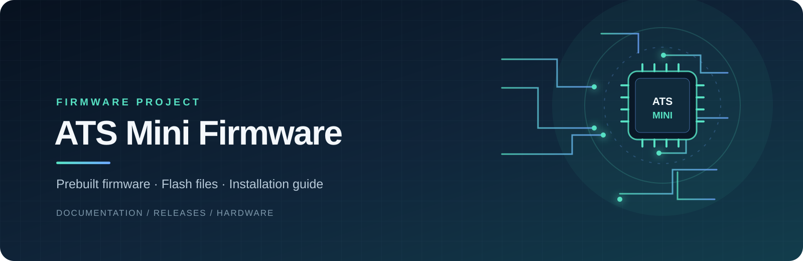

<p align="center">
  
</p>

<h1 align="center">ATS Mini Firmware</h1>

<p align="center">
  KALIMAN firmware and recovery images for compatible ATS Mini SI4732 ESP32-S3 radios.<br>
  Firmware KALIMAN e imágenes de recuperación para radios ATS Mini SI4732 ESP32-S3 compatibles.
</p>

<p align="center">
  <a href="https://github.com/satan666000/ATS-MINI-FIRMWARE/actions/workflows/firmware.yml"></a>
  <a href="https://github.com/satan666000/ATS-MINI-FIRMWARE/releases/latest"></a>
  
  
  
</p>

<p align="center">
  <a href="#overview">English</a> ·
  <a href="#español">Español</a> ·
  <a href="docs/FLASHING.md">Flashing guide / Guía de flasheo</a>
</p>

---

<details>
<summary><strong>Contents / Contenido</strong></summary>

**English:** [Overview](#overview) · [Firmware files](#firmware-files) · [Quick flashing](#quick-flashing) · [Build](#build-from-source) · [Safety](#compatibility-and-safety)

**Español:** [Descripción](#español) · [Archivos](#archivos-de-firmware) · [Flasheo](#flasheo-rápido) · [Compilación](#compilar-desde-el-código-fuente) · [Seguridad](#compatibilidad-y-seguridad)
</details>

## Overview

This repository contains the KALIMAN firmware source and a prebuilt recovery package for compatible ATS Mini SI4732 ESP32-S3 radios. Verify the exact board model and hardware revision before installing any image.

### Firmware files

| File | Purpose | Flash offset |
| --- | --- | ---: |
| `ATSMINI/bootloader.bin` | Bootloader | `0x00000` |
| `ATSMINI/partitions.bin` | Partition table | `0x08000` |
| `ATSMINI/boot_app0.bin` | Application boot image | `0x0E000` |
| `ATSMINI/firmware.bin` | Main firmware | `0x10000` |

### Source and project files

| Path | Description |
| --- | --- |
| `main.cpp` | Firmware application and radio behavior |
| `Display.h` | ATS Mini display driver |
| `Languages.h` | User-interface translations |
| `SSBPatch.h` | SSB patch implementation |
| `include/Remote.h` | Wi-Fi and BLE remote-control support |
| `ci/platformio-release.ini` | PlatformIO release-build configuration |
| `.github/workflows/firmware.yml` | Firmware build and release workflow |

### Quick flashing

**Requirements:** Python 3.x, `esptool`, a USB data cable, and the radio in programming mode.

Install `esptool`:

```bash
python -m pip install esptool
```

From the repository root, replace `<PORT>` with the radio's serial port (`COMx` on Windows or `/dev/tty...` on Linux/macOS):

```bash
python -m esptool --port <PORT> write-flash \
  0x00000 ATSMINI/bootloader.bin \
  0x08000 ATSMINI/partitions.bin \
  0x0E000 ATSMINI/boot_app0.bin \
  0x10000 ATSMINI/firmware.bin
```

> **Before flashing:** confirm hardware compatibility and back up the existing firmware. Do not erase the full flash unless the device-specific instructions explicitly require it.

See the [complete flashing guide](docs/FLASHING.md) and [flash-offset list](ATSMINI/FLASH-OFFSETS.txt) for details.

### Build from source

Install the PlatformIO version used by CI, then build the ATS Mini environment:

```bash
python -m pip install platformio==6.1.18
pio run --project-conf ci/platformio-release.ini -e ats-mini
```

GitHub Actions also builds the firmware for pushes and pull requests. A versioned release requires an `X.Y.Z` tag that matches `FIRMWARE_VERSION` in `main.cpp`.

### Compatibility and safety

- Confirm the exact ATS Mini model and hardware revision before flashing.
- Use only images built for compatible hardware.
- Keep a backup of important device data and configuration.
- `firmware.bin` contains the application; it is not a full-flash backup.
- Do not share device serial numbers, credentials, or personal information in support requests.

### Support

When reporting an issue, include the board model and revision, operating system, `esptool` version, serial port, and exact error message.

### License

This repository does not declare an explicit license. Do not assume that its source code, firmware, or binaries may be reused, redistributed, or modified without permission from the rights holder. Preserve all third-party notices; the SSB patch has a commercial redistribution restriction.

---

## Español

Este repositorio contiene el código fuente del firmware KALIMAN y un paquete de recuperación precompilado para radios ATS Mini SI4732 ESP32-S3 compatibles. Verifica el modelo y la revisión exactos de la placa antes de instalar cualquier imagen.

### Archivos de firmware

| Archivo | Función | Dirección de flasheo |
| --- | --- | ---: |
| `ATSMINI/bootloader.bin` | Bootloader | `0x00000` |
| `ATSMINI/partitions.bin` | Tabla de particiones | `0x08000` |
| `ATSMINI/boot_app0.bin` | Imagen de arranque de la aplicación | `0x0E000` |
| `ATSMINI/firmware.bin` | Firmware principal | `0x10000` |

### Código fuente y archivos del proyecto

| Ruta | Descripción |
| --- | --- |
| `main.cpp` | Aplicación del firmware y funcionamiento de la radio |
| `Display.h` | Controlador de pantalla del ATS Mini |
| `Languages.h` | Traducciones de la interfaz |
| `SSBPatch.h` | Implementación del parche SSB |
| `include/Remote.h` | Control remoto por Wi-Fi y BLE |
| `ci/platformio-release.ini` | Configuración de compilación de lanzamiento |
| `.github/workflows/firmware.yml` | Flujo de compilación y publicación del firmware |

### Flasheo rápido

**Requisitos:** Python 3.x, `esptool`, un cable USB con datos y la radio en modo de programación.

Instala `esptool`:

```bash
python -m pip install esptool
```

Desde la raíz del repositorio, reemplaza `<PORT>` por el puerto serie de la radio (`COMx` en Windows o `/dev/tty...` en Linux/macOS):

```bash
python -m esptool --port <PORT> write-flash \
  0x00000 ATSMINI/bootloader.bin \
  0x08000 ATSMINI/partitions.bin \
  0x0E000 ATSMINI/boot_app0.bin \
  0x10000 ATSMINI/firmware.bin
```

> **Antes de flashear:** confirma la compatibilidad del hardware y guarda una copia del firmware actual. No borres toda la memoria flash salvo que las instrucciones específicas del dispositivo lo exijan.

Consulta la [guía completa de flasheo](docs/FLASHING.md) y la [lista de direcciones](ATSMINI/FLASH-OFFSETS.txt) para obtener más detalles.

### Compilar desde el código fuente

Instala la misma versión de PlatformIO que utiliza CI y compila el entorno ATS Mini:

```bash
python -m pip install platformio==6.1.18
pio run --project-conf ci/platformio-release.ini -e ats-mini
```

GitHub Actions también compila el firmware en cada envío de cambios y pull request. Para publicar una versión se requiere una etiqueta `X.Y.Z` que coincida con `FIRMWARE_VERSION` en `main.cpp`.

### Compatibilidad y seguridad

- Confirma el modelo y la revisión exactos del ATS Mini antes de flashear.
- Usa solo imágenes compiladas para hardware compatible.
- Conserva una copia de seguridad de los datos y la configuración importantes.
- `firmware.bin` contiene la aplicación; no es una copia completa de la memoria flash.
- No compartas números de serie, credenciales ni datos personales en solicitudes de soporte.

### Soporte

Al informar un problema, incluye el modelo y la revisión de la placa, el sistema operativo, la versión de `esptool`, el puerto serie y el mensaje de error exacto.

### Licencia

Este repositorio no declara una licencia explícita. No supongas que el código fuente, el firmware o los binarios pueden reutilizarse, redistribuirse o modificarse sin permiso del titular de los derechos. Conserva todos los avisos de terceros; el parche SSB tiene restricciones de redistribución comercial.
